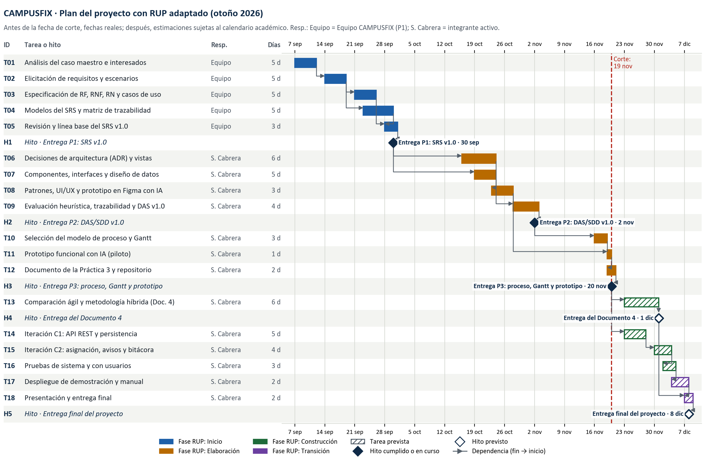

# Equipo02_CAMPUSFIX_Practica3

Prototipo funcional de **CAMPUSFIX**, el sistema para reportar y dar seguimiento a incidencias de infraestructura (aulas, laboratorios, sanitarios, red y mobiliario) de la Universidad Metropolitana del Centro, Campus Centro. La universidad y todos los datos son ficticios.

Práctica 3 de Ingeniería de Software: proceso tradicional, diagrama de Gantt y prototipo asistido por IA. El prototipo se construye sobre el **SRS v1.0** y el **DAS/SDD v1.0** del caso.

| | |
|---|---|
| Caso maestro | CAMPUSFIX |
| Equipo | Equipo02 |
| Integrante | Samuel de María Cabrera Flores (por ahora, trabajo individual) |
| Versión | 0.1.0 · 19 de noviembre de 2026 |

> Es una **demostración parcial** de la fase de Elaboración. No es el sistema completo, no tiene servidor ni seguridad real y no está validado para uso en producción.

## Qué hace

Cinco pantallas con navegación real y permisos por rol:

1. **Acceso institucional** (PAN-01): valida el correo institucional y ofrece acceso rápido con cuentas de demostración.
2. **Listado por rol** (PAN-02/03): Mis incidencias (Reportante), Bandeja (Mesa de servicio), Mi tablero (Técnico) y Validaciones (Supervisor), con búsqueda y filtros.
3. **Reportar incidencia** (PAN-05/06/07): asistente de cuatro pasos con errores por campo, fotografía y confirmación con folio.
4. **Detalle con historial** (PAN-04/08/09/10): cronología, notas internas, bitácora y las acciones de cada rol.
5. **Indicadores** (PAN-11): estado, prioridad, ubicación, recurrentes, fallas críticas y exportación CSV.

Funcionalidades verificables:

- Folio único `CF-AAAAMMDD-XXXX` al enviar un reporte (RN-001).
- Validación del formulario por paso y de la foto (JPEG, PNG o WebP de hasta 5 MB).
- Prioridad calculada con una regla intercambiable (patrón Strategy). La matriz es **provisional** hasta que la Dirección apruebe la definitiva (PP-01).
- Máquina de estados de la Tabla 30 del DAS con permisos por rol.
- Detección y vinculación de duplicados que conservan su reportante (RN-003).
- Avisos y bitácora como observadores de los cambios de estado (patrón Observer).
- Cierre con foto o motivo obligatorio (RN-005) y validación del Supervisor.
- Reapertura dentro de 48 horas hábiles (RN-004, RN-009).
- Filtrado por texto, estado y prioridad; indicadores calculados y CSV.

Recorridos completos del DAS: **FLU-01** (reportar), **FLU-02** (validar, vincular duplicado y asignar) y **FLU-03** (diagnosticar, poner en espera, resolver y validar).

### Cuentas de demostración

Cualquier contraseña no vacía funciona y no se guarda. También se puede entrar con un clic desde la pantalla de acceso.

| Persona | Rol | Para probar |
|---|---|---|
| Lucía Méndez | Reportante | FLU-01 y reapertura |
| Diego Ramírez | Reportante | Reporte duplicado (0048) |
| Ana Salas | Mesa de servicio | FLU-02 con CF-20261023-0042 |
| Javier Torres / María López | Técnico (Plomería) | FLU-03 |
| Elena Ruiz | Supervisor | Validar cierre y reasignar |
| Daniel Ortega | Dirección administrativa | Indicadores |

La demostración arranca el 23 oct 2026 a las 09:38 (reloj simulado). El botón **Reiniciar demo** restaura los datos iniciales.

## Tecnología

- React 19 y Vite 8, JavaScript (ES2022), CSS propio sin bibliotecas de componentes.
- Estado en memoria con persistencia en `localStorage`; sin backend.
- Pruebas de dominio con el ejecutor nativo de Node (`node --test`).

## Ejecutar en local

Requiere Node.js 20.19 o superior.

```bash
npm install
npm run dev        # abre http://localhost:5173
npm test           # 15 pruebas de las reglas de dominio
npm run build      # genera dist/, que se puede servir desde cualquier carpeta
```

## Estructura

```text
src/
  dominio/       Reglas de negocio por componente del DAS (COMP-01 a COMP-08)
  datos/         Datos ficticios iniciales tomados del prototipo de Figma
  estado/        Almacén con reloj simulado y rutas por hash
  componentes/   Encabezado, menú, tabla, mensajes, chips y utilidades de foto
  pantallas/     Acceso, Listado, Reportar, Detalle (con un panel por rol) e Indicadores
  estilos/       Hoja de estilos con la guía visual del DAS
pruebas/         Pruebas de FLU-01, FLU-02, FLU-03 y RN-001 a RN-010
docs/
  trazabilidad.md  Componentes y pantallas del DAS → archivos, con pendientes
  ia/              Prompts, iteraciones y reflexión sobre el uso de IA
  capturas/        Diseño (D1–D5), prototipo (P01–P12) e iteración (I1)
  figuras/         Gantt, trazabilidad y despliegue actualizado (PNG y .drawio)
```

## Proceso y plan

El proyecto sigue **RUP adaptado con un ciclo de prototipado en Elaboración**. Este prototipo corresponde a la segunda iteración de Elaboración (hito LCA): es un piloto del frontend, no la fase de Construcción.



El despliegue actual y el pendiente están en [`docs/figuras/despliegue-actualizado.png`](docs/figuras/despliegue-actualizado.png).

## Uso de inteligencia artificial

Se usaron dos herramientas, en este orden:

1. **Claude Design** (Claude Opus 5.5) para definir una identidad visual propia y cinco pantallas base a partir de las reglas de estilo del DAS. Prompt en [`docs/ia/01-prompt-diseno.md`](docs/ia/01-prompt-diseno.md); capturas D1 a D5.
2. **Claude Code** (Claude Opus 5.5) para implementar el prototipo funcional. Prompt en [`docs/ia/02-prompt-implementacion.md`](docs/ia/02-prompt-implementacion.md). Los commits llevan la línea `Co-Authored-By: Claude`.

Las iteraciones y correcciones están en [`docs/ia/03-iteraciones-y-reflexion.md`](docs/ia/03-iteraciones-y-reflexion.md): errores que encontraron las pruebas, la regla RN-010 que faltaba tras revisar el SRS y los ajustes después de comparar con Figma (capturas antes y después).

La IA generó código y textos; el integrante definió el alcance, eligió qué usar del SRS, del DAS y de Figma, y revisó los resultados. No se cargaron datos personales reales ni contraseñas en ninguna herramienta.

## Limitaciones

Ver [`docs/trazabilidad.md`](docs/trazabilidad.md). En resumen: sin servidor, base de datos, directorio institucional ni correo; las notificaciones son avisos dentro de la aplicación; la regla de prioridad y el calendario laboral son provisionales; faltan el escalamiento automático (RF-014) y la configuración de catálogos (RF-025).
